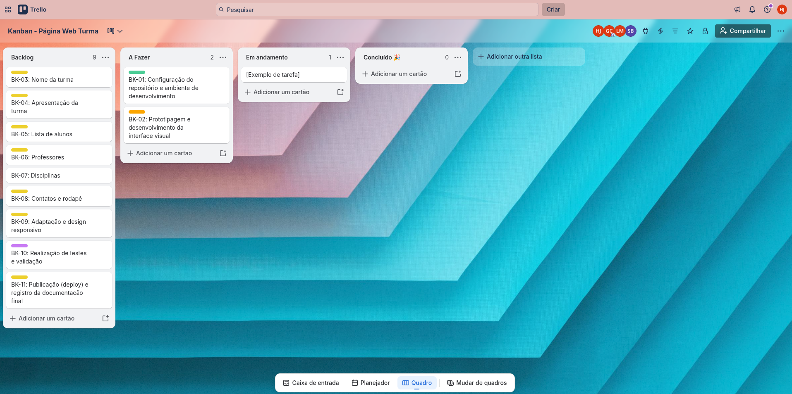

# Engenharia de Software 2026.2 [](https://es-2026-2.vercel.app)

Landing page da turma de Engenharia de Software, 5º semestre, turno da tarde, ingresso em 2024. O período letivo é o 2026.2.

A página apresenta a sala, os professores, os alunos e as disciplinas deste semestre.

## Sobre

A turma ingressou em 2024 e hoje cursa o 5º semestre no turno da tarde. Neste período a sala percorre arquitetura de software, gerência de projetos, processos de desenvolvimento, redes de computadores e robótica móvel.

Na página, a seção **Jornada** reúne esse texto, os contadores e o mapa dos semestres. A docente responsável pela turma é a professora Jacqueline Cristina Teixeira do Rosario.

## Equipe do projeto

| Integrante | Papel |
| --- | --- |
| Gustavo Neves Coelho | Gerente de Projetos |
| Hanrry Julio Araujo Santos | Testador |
| Luiz Felipe Meneses Ferreira | Desenvolvedor |
| Saylon da Rocha Batista | Design |

## Gestão do projeto

O trabalho foi organizado no Trello com a metodologia Kanban. As atividades foram distribuídas entre Backlog, A Fazer, Em Andamento e Concluído.

**Quadro Kanban público:** [Kanban — Página Web Turma](https://trello.com/b/yLjVLrO2/kanban-pagina-web-turma)

### Backlog

- **BK-01:** Configuração do repositório e ambiente de desenvolvimento
- **BK-02:** Prototipagem e desenvolvimento da interface visual
- **BK-03:** Nome da turma
- **BK-04:** Apresentação da turma
- **BK-05:** Lista de alunos
- **BK-06:** Professores
- **BK-07:** Disciplinas
- **BK-08:** Contatos e rodapé
- **BK-09:** Adaptação e design responsivo
- **BK-10:** Realização de testes e validação
- **BK-11:** Publicação e registro da documentação final

### Planejamento inicial

No início do projeto, as tarefas foram mapeadas e organizadas nas colunas Backlog, A Fazer e Em Andamento.



## Alunos

São 16 alunos, em ordem alfabética, na tela de seleção de jogador.

- Cybele Isabela dos Santos Silva
- Gustavo Neves Coelho
- Hanrry Julio Araujo Santos
- Hortencia Gomes Silva
- Igo Roberth Costa Martins
- Ikki Silva Carvalho
- Israel Martins de Moura Barros
- Italo Dannyel Silva da Silva
- Jose Gomes Cabral Neto
- Lucas Daniel Brito Queiroz
- Lucas Henrique Oliveira Souza
- Luiz Felipe Meneses Ferreira
- Mauricio Araujo Lucas
- Nicolas Gabriel Cunha de Sousa
- Saylon da Rocha Batista
- Vitoria Mota Ribas

A página mostra apenas o nome e a foto. Matrícula, usuário e e-mail pessoal ficam de fora.

## Professores

Uma carta por professor, com foto (ou as iniciais, enquanto não houver imagem), a disciplina e um resumo.

| Professor | Disciplina |
| --- | --- |
| Jacqueline Cristina Teixeira do Rosario | Arquitetura de Software e Gerência de Projetos |
| Alan Cloves Silva Barreto | Fundamentos de Redes de Computadores |
| Vanessa Castro Rezende | Processos de Desenvolvimento de Software |
| Keny Lucas da Silva Goes | Robótica Móvel |

Para incluir a foto, gere o arquivo com o script de fotos e preencha o campo `foto` do professor em `src/data/turma.ts`.

## Disciplinas

Grade do 5º semestre, turno da tarde:

- Arquitetura de Software
- Gerência de Projetos
- Fundamentos de Redes de Computadores
- Processos de Desenvolvimento de Software
- Robótica Móvel

## O site

A página é um jogo 8 bits que se joga rolando. O mundo é colorido, no estilo dos jogos de plataforma, e a interface (diálogos, menus e batalhas) segue o estilo do Undertale: caixas pretas de borda branca, falas com "* " e a SOUL vermelha como cursor. A arte, os sons e os textos são próprios; nada do jogo original é usado.

- **Abertura:** intro em quadros, com texto digitado, até a tela de título. Enter passa, Esc pula.
- **Início:** ilha flutuante em voxels (three.js), renderizada em baixa resolução para o pixel ficar visível.
- **Jornada:** mapa de mundo do 1º ao 5º semestre; o personagem anda pela trilha conforme a rolagem. A estrela no meio do caminho é um ponto de save.
- **Docente:** a docente responsável fala numa caixa de diálogo, com retrato.
- **Jogadores:** seleção de personagem com os 16 alunos e ficha no estilo da tela STAT. As fotos aparecem pixeladas e ficam nítidas ao selecionar. Setas navegam e Enter abre o "É este o nome?".
- **Mestres:** cada professor é um encontro de batalha com LUTAR, AGIR, ITEM e MISERICÓRDIA. Ninguém sai ferido.
- **Disciplinas:** cada disciplina é um "mundo" (5-1 a 5-5) para selecionar.
- **Fim:** a SOUL se parte, GAME OVER... e "ainda não".

Efeitos sonoros chiptune são gerados no navegador e começam desligados (botão de som no topo). Com "reduzir movimento" ativado no sistema, a abertura, a rolagem suave e as animações presas à rolagem ficam de fora.

## Estrutura do projeto

```
/
├── index.html
├── public/
│   └── fotos/              # fotos otimizadas (webp 512px), geradas pelo script
├── scripts/
│   └── otimizar-fotos.mjs  # gera public/fotos a partir da pasta original
├── src/
│   ├── data/turma.ts       # alunos, professores, disciplinas e textos
│   ├── components/         # uma seção por arquivo
│   ├── lib/                # som, rolagem (Lenis) e movimento (GSAP)
│   └── styles/             # tokens, base e estilos das seções
└── vite.config.ts
```

## Como rodar

Requer Node 18 ou mais novo.

```bash
npm install
npm run dev
```

`npm run build` gera a versão de produção em `dist/`.

## Como editar

- Nomes, textos e disciplinas ficam em `src/data/turma.ts`.
- Para trocar ou incluir fotos, coloque os arquivos numa pasta e rode `npm run fotos -- "caminho/da/pasta"`. O mapeamento de nome do arquivo para aluno fica no começo de `scripts/otimizar-fotos.mjs`, junto dos recortes manuais das fotos de corpo inteiro. A pasta original não é alterada.

## Publicação (Vercel)

O projeto agora usa Vite. Nas configurações do projeto na Vercel, o preset deve ser **Vite** (comando `npm run build`, saída `dist`).

## Tecnologias

- React 18 + TypeScript, com Vite
- three.js (@react-three/fiber) no cenário 3D
- GSAP (ScrollTrigger e MotionPath) nas animações
- Lenis na rolagem suave
- Fontes Press Start 2P e VT323, servidas pelo próprio site
